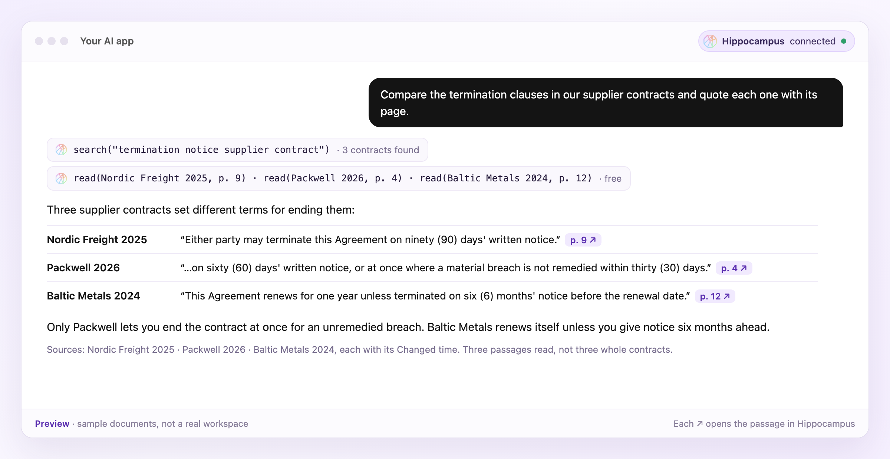
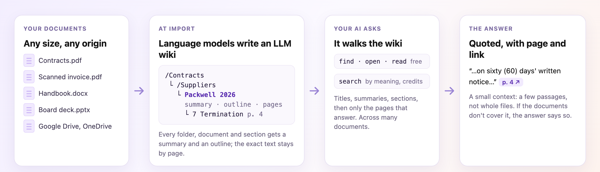

<p align="center"></p>

<h1 align="center">Thalius Hippocampus</h1>

<p align="center"><b>An expert on your company's documents, for any AI app.</b><br>
A remote MCP server for Claude, ChatGPT, Cursor, VS Code, Codex, Gemini and other agents.</p>

<p align="center">
<a href="https://cursor.com/install-mcp?name=hippocampus&config=eyJ1cmwiOiJodHRwczovL2hpcHBvY2FtcHVzLnRoYWxpdXMuYWkvbWNwIn0="></a>
<a href="https://vscode.dev/redirect?url=vscode%3Amcp%2Finstall%3F%257B%2522name%2522%253A%2522hippocampus%2522%252C%2522type%2522%253A%2522http%2522%252C%2522url%2522%253A%2522https%253A%252F%252Fhippocampus.thalius.ai%252Fmcp%2522%257D"></a>
<a href="https://kiro.dev/launch/mcp/add?name=hippocampus&config=%7B%22url%22%3A%22https%3A%2F%2Fhippocampus.thalius.ai%2Fmcp%22%7D"></a>
</p>

Turns your company's documents into an expert your AI consults: an LLM-built wiki that answers complex questions across many files, quoting the source of truth with page and link, in a small context. Includes a skill that picks the cheapest tool for each question.

**You need a Thalius account. A free account works:** https://hippocampus.thalius.ai/register

[How to use it](#how-to-use-it) · [Why](#why-hippocampus) · [How it works](#how-it-works) · [What you can ask](#what-you-can-ask) · [Connect your AI app](#connect-your-ai-app) · [Tools](#tools) · [Evidence](#evidence) · [Security](#security-and-privacy) · [FAQ](#faq)

## How to use it



*Preview with sample documents. A screenshot from each app is added below as Hippocampus is listed there.*

1. **Connect** your AI app: install the plugin or add the server address (see [Connect your AI app](#connect-your-ai-app)).
2. **Sign in** in your browser the first time, with your Thalius account. The assistant then acts as you and sees only the documents you may see.
3. **Ask in your own words**, about one document or many. The assistant picks the tools: free lookups first, a search when it needs one.
4. **Check the answer.** Each claim quotes the source with its page and a link that opens the passage.

## Why Hippocampus

Your AI is as good as what it can read. Hippocampus gives it your company's documents the way an expert knows them: organised, summarised and exact to the page.

| Your AI without Hippocampus | Your AI with Hippocampus |
|---|---|
| Chunk-based vector search cuts documents into pieces and returns look-alike chunks from different files | It walks a wiki of your documents and reaches the section that answers |
| Fast on simple lookups, but loses the thread on complex questions and large collections | Complex questions across many documents: compare, list every clause on a topic, follow a decision through its sources |
| Whole files pasted into the chat fill the context window | A few passages, not whole files: the context stays small |
| Answers you cannot check | Every claim quoted with its document, page and a link that opens it |
| Guesses when the documents are silent | Says so when the documents do not cover the question |
| Files copied into each AI app, one person at a time | One source of truth for the team, read by every AI app with each person's own access |

## How it works



- **At import**, language models write your documents into an LLM wiki: folders, documents and sections, each with a summary and an outline, the exact text kept by page. PDF, scanned PDF, Word, PowerPoint, Excel, Markdown and text; Google Drive and OneDrive.
- **A question** walks titles, summaries and sections and reaches the exact passage, even across many documents. Finding, opening and reading are free; search by meaning uses credits. Search itself runs no generative model: it returns the passages, and your AI writes the answer.
- **The answer** quotes the source with its page and a link into Hippocampus, so anyone can check it.
- **It is also your team's shared memory.** When you ask, the assistant adds a decision, meeting notes or a new procedure, and it stays for the team.

More: [about/overview.md](about/overview.md) · [how it works on thalius.ai](https://www.thalius.ai/developers/how-it-works).

## What you can ask

- "What does our employee handbook say about remote work? Quote the passage and its page."
- "Compare the termination clauses in our supplier contracts and quote each one with its page."
- "Save these meeting notes to /Meetings in Hippocampus."

| Team | Ask | What happens |
|---|---|---|
| Legal and procurement | "Compare the termination clauses in our supplier contracts." | Searches across the contracts, reads each clause, quotes every one with its document, page and link |
| Business processes | "Check this offer against our discount rules." | Reads the current rules and names the rule behind each correction, with its page |
| Engineering | "What does the spec say about the retry limit, and which design decision set it?" | Reads the specification section and the decision record, quotes both with their pages |
| Research and regulatory | "What do our reports say about sample retention?" | Searches across every report, groups the extracts by document |
| Finance and board | "What risks does the latest board report list?" | Finds the newest report by name, reads its risk section, cites each item |
| Developers | "Build an agent that answers HR questions from our handbook." | Uses search and read as the retrieval step, with citations in every answer |

More: [about/use-cases.md](about/use-cases.md).

## Connect your AI app

Server address: `https://hippocampus.thalius.ai/mcp` (Streamable HTTP). Every app signs in with OAuth in your browser the first time: there is no key to paste. One connection reaches one workspace, and the AI sees exactly what you may see in it.

<details>
<summary><b>Claude Code</b>: plugin (server and skill) or server only</summary>

Plugin, with the skill that picks the cheapest tool for each question:

```bash
claude plugin marketplace add thalius-ai/hippocampus-plugin
claude plugin install thalius-hippocampus@thalius
```

Server only (`--scope user` makes it available in all your projects):

```bash
claude mcp add --transport http --scope user hippocampus https://hippocampus.thalius.ai/mcp
```

Then run `/mcp` in Claude Code, pick `hippocampus` and sign in, or run `claude mcp login hippocampus` from the shell.
</details>

<details>
<summary><b>Claude</b> (claude.ai and Claude Desktop)</summary>

1. Open **Customize → Connectors**.
2. Click **+ Add**, then **Add custom connector**.
3. Enter the name `Hippocampus` and the server address, then click **Continue**.
4. Keep OAuth as the authentication, then click **Add**.
5. In a chat, open **+ → Connectors** and turn Hippocampus on.

On Team and Enterprise plans an Owner adds the connector under **Organization settings → Connectors** (**Add → Custom → Web**), and members then **Connect** it under **Customize → Connectors**.
</details>

<details>
<summary><b>ChatGPT</b></summary>

1. Open ChatGPT Plugins (`https://chatgpt.com/plugins`).
2. **+ → Add custom MCP server**.
3. Name and description; Connection: the server address.
4. Authentication: OAuth. Review the warning and confirm.
5. **Create as a plugin**, then review the tools ChatGPT found.

Plan and workspace rules for custom MCP servers are ChatGPT's own.
</details>

<details>
<summary><b>Codex</b></summary>

```bash
codex mcp add hippocampus --url https://hippocampus.thalius.ai/mcp
codex mcp login hippocampus
```

Or in `~/.codex/config.toml`:

```toml
[mcp_servers.hippocampus]
url = "https://hippocampus.thalius.ai/mcp"
```
</details>

<details>
<summary><b>Cursor</b></summary>

Use the **Add to Cursor** button above, add this repository as a plugin, or put this in `.cursor/mcp.json` (one project) or `~/.cursor/mcp.json` (every project):

```json
{
  "mcpServers": {
    "hippocampus": {
      "url": "https://hippocampus.thalius.ai/mcp"
    }
  }
}
```

Cursor finds the sign-in itself and refreshes it.
</details>

<details>
<summary><b>VS Code</b> (GitHub Copilot)</summary>

Use the **Install in VS Code** button above, or Command Palette → **MCP: Add Server** → HTTP → the server address. Or `.vscode/mcp.json`:

```json
{
  "servers": {
    "hippocampus": {
      "type": "http",
      "url": "https://hippocampus.thalius.ai/mcp"
    }
  }
}
```

A browser opens for sign-in on the first connection.
</details>

<details>
<summary><b>Gemini CLI</b></summary>

As an extension (server and context file):

```bash
gemini extensions install https://github.com/thalius-ai/hippocampus-plugin
```

Or the server only:

```bash
gemini mcp add --transport http hippocampus https://hippocampus.thalius.ai/mcp
```

Then sign in with `/mcp auth hippocampus`. Gemini CLI's sign-in needs a local browser.
</details>

<details>
<summary><b>Antigravity, Kiro, Devin, Cline</b></summary>

| App | How |
|---|---|
| Antigravity | Import this repository as a plugin, or add the server address in the MCP settings |
| Kiro | The **Add to Kiro** button above, or this repository as a power |
| Devin | Add this repository as a plugin |
| Cline | MCP Servers → Remote Servers: name `hippocampus`, the server address, Streamable HTTP. See [llms-install.md](llms-install.md) |
</details>

<details>
<summary><b>Any other MCP client</b></summary>

Point it at `https://hippocampus.thalius.ai/mcp` (Streamable HTTP, OAuth). The client must read the protected-resource metadata at `/.well-known/oauth-protected-resource/mcp`; clients written to the 2025-03-26 MCP spec look for the sign-in on the server's own host and do not find it.

Before sign-in, a client or directory can read the server card at `https://hippocampus.thalius.ai/mcp/server-card` (MCP Server Cards).
</details>

Menus move between app versions. If a step looks different, follow the app's own guide to adding a remote MCP server. Guides for each client: https://www.thalius.ai/developers/mcp

## Tools

| Tool | What it does | Cost |
|---|---|---|
| `start` | Workspace map, permissions, credits | free |
| `search` | Search by meaning; extracts with section, pages and a link | credits |
| `find` | A document by name, or the recently changed | free |
| `open` | A folder, a document outline or a section | free |
| `read` | The exact text, or where a word occurs | free |
| `balance` | Plan and credits left | free |
| `ingest`, `ingest_status` | Add a document and follow the import | credits per page |

Every tool but `ingest` is read-only, and `ingest` adds documents only in folders where you can add them yourself. The server also offers two prompts, `ask` (a question, answered with quotes) and `overview` (the workspace's top folders, your permissions and the credits left), and a guide resource, `hippocampus://guide`.

Reference: [about/tools.md](about/tools.md) · credits: [about/credits.md](about/credits.md) · plans and prices: https://www.thalius.ai/pricing.

## Evidence

Thalius tested the search on two public benchmarks on 20 October 2026, against Azure AI Search, Vertex AI Search and two OpenAI searches (File Search, Direct Search). Every system made one search per question, with the same answer model and the same judge.

| Benchmark | What it asks | Hippocampus | Next highest |
|---|---|---|---|
| FinanceBench (Patronus AI) | 150 analyst questions on 84 US company filings | 92.2% | 76.6% (Azure AI Search) |
| LegalBench-RAG (ZeroEntropy) | 776 questions on 72 contracts and privacy policies | 85.7% | 78.3% (Azure AI Search) |

Success rate: of the questions a perfect search would solve, the share each system gets right with its own search. The trade-off: a median search takes 1.8 s, against 0.3 to 0.4 s for Vertex AI Search and Azure AI Search. On ten public FDA documents (2,198 pages) with Claude Opus 5 answering, a control question the documents cannot answer was declined in all six repetitions. Method, data and every answer: https://www.thalius.ai/evidence

## Security and privacy

- Documents are stored encrypted in the EU (Finland), each with its own key, and are never used to train AI models.
- The assistant acts as you: one connection, one workspace, exactly your permissions.
- Text from documents reaches the AI marked as quoted data, never as instructions.
- A sign-in lasts 30 days. You can end an app's access at once in Hippocampus.
- The text your assistant receives is processed by your AI app under its own terms.

Details: [about/security-privacy.md](about/security-privacy.md), https://www.thalius.ai/security and https://www.thalius.ai/legal/privacy.

## FAQ

<details>
<summary><b>Is this RAG?</b></summary>

It is retrieval for your AI, but not chunk-based vector search. Language models write your documents into a wiki at import; a question walks it and returns whole, cited passages. Your AI writes the answer from them.
</details>

<details>
<summary><b>What does the assistant see?</b></summary>

Exactly the documents you may see in Hippocampus, nothing else. It cannot delete or edit documents; it adds one only when you ask, and only where you can add documents yourself.
</details>

<details>
<summary><b>The first call answers 401. Is that an error?</b></summary>

No. The app has no session yet; it reads the sign-in metadata and opens the sign-in page by itself.
</details>

<details>
<summary><b>How do I connect another workspace?</b></summary>

One connection reaches one workspace. Remove the connector, add it again and choose the other workspace when you sign in.
</details>

<details>
<summary><b>What costs credits?</b></summary>

Searching and adding documents. Finding, opening, reading and checking the balance are free. A free account works; plans and prices: https://www.thalius.ai/pricing
</details>

<details>
<summary><b>Does this repository run anything on my machine?</b></summary>

No. It holds configuration for each AI app, one skill that teaches the assistant to use Hippocampus at the lowest credit cost, test cases and the documentation in the about folder. No scripts, hooks or binaries. It connects only to `https://hippocampus.thalius.ai/mcp`.
</details>

More: [about/faq.md](about/faq.md).

## Links

| | |
|---|---|
| Website | https://www.thalius.ai |
| Developer docs | https://www.thalius.ai/developers/mcp |
| Evidence | https://www.thalius.ai/evidence |
| Plans and prices | https://www.thalius.ai/pricing |
| Terms | https://www.thalius.ai/legal/terms |
| Support | support@thalius.ai |

## License

MIT for the contents of this repository. Using the Hippocampus service requires a Thalius account and is subject to the terms above.
